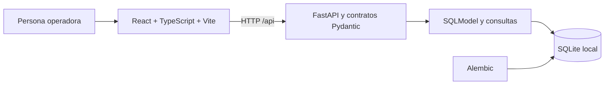
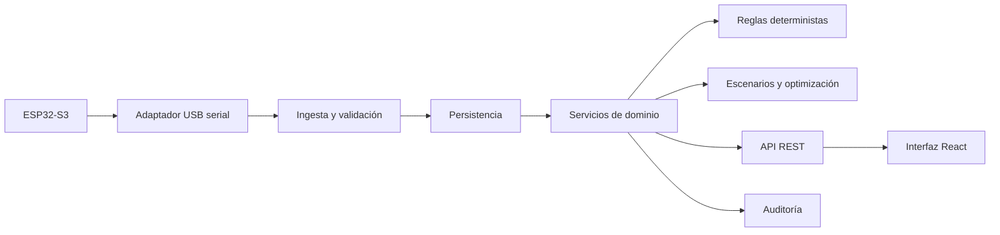

# Arquitectura

## Sistema local de la Fase 1

`frontend/` contiene la interfaz y sus tipos de API. `backend/app/` contiene API, modelos, validación y gestión de base. `backend/migrations/` contiene cambios versionados. `backend/tests/` valida comportamiento con bases temporales. `firmware/` y `hardware/` reservan la integración posterior. `scripts/` documenta la operación Windows. `docs/referencias/` conserva copias locales de los documentos aportados.

La API mantiene el contrato público y la validación. SQLModel declara las entidades; Alembic crea y actualiza la estructura. El arranque aplica migraciones, sin insertar datos operativos. El frontend consulta la API y permite alta manual de configuración; no toca SQLite ni puertos seriales.

La aplicación opera en `observation`, con `control_enabled: false`. Registrar un dispositivo no demuestra que esté conectado. El estado inicial es `not_configured`, `last_seen_at` es nulo y las mediciones permanecen vacías.

## Fronteras y errores

- El frontend distingue servicio no accesible de consulta exitosa sin datos; una falla HTTP no se representa como cero.
- La API escucha localmente. En desarrollo, Vite redirige `/api` a `127.0.0.1:8000`; los orígenes CORS permitidos son locales y explícitos.
- SQLite activa claves foráneas en cada conexión. La ruta de base se resuelve desde `backend/`, de forma estable entre comandos.
- Las fechas se normalizan a UTC al persistir y se serializan con zona explícita. SQLite almacena la representación UTC; el adaptador devuelve fechas conscientes de zona.
- Las migraciones fallidas impiden completar el inicio. Los errores de acceso posteriores a la base devuelven 503, sin exponer detalles internos.
- No se incluye autenticación en esta fase. Antes de compartir acceso en red se requiere implementar roles, permisos y revisar la exposición del servicio.

## Capas previstas

Este segundo diagrama describe el destino de diseño; el adaptador, la ingesta, las reglas, los escenarios y la auditoría todavía no están implementados. No se crean capas vacías duplicadas por anticipación: se extraerán servicios y repositorios al incorporar su primer caso real.

La futura ingesta verificará identidad del dispositivo/sensor, zona, magnitud, unidad, timestamp, calidad y vigencia. Los límites dependerán de cultivo y fuente. Los escenarios leerán copias de datos y escribirán sólo en tablas de escenarios; no pasarán por el canal de comandos.

La actuación futura requerirá comandos autorizados con alcance, vencimiento, confirmación, cancelación y auditoría. No existe tal canal en Fase 1. El motor determinista será independiente de cualquier modelo generativo. Los mínimos de la instalación habitada quedan fuera del poder de decisión del biodomo.

## Origen de las fronteras

El expediente separa las seis funciones y sus interfaces (pp. 17-20), sectores y laboratorio (pp. 31 y 36), calidad instrumental y autonomía limitada (p. 39), alternativas y autoridad (pp. 41-43) y emergencia con conservación del historial (p. 60). Las capturas aportan jerarquía visual, no datos. La elección de Vite sigue la especificación del usuario; la sugerencia de Next.js del PDF p. 41 no se incorpora.
