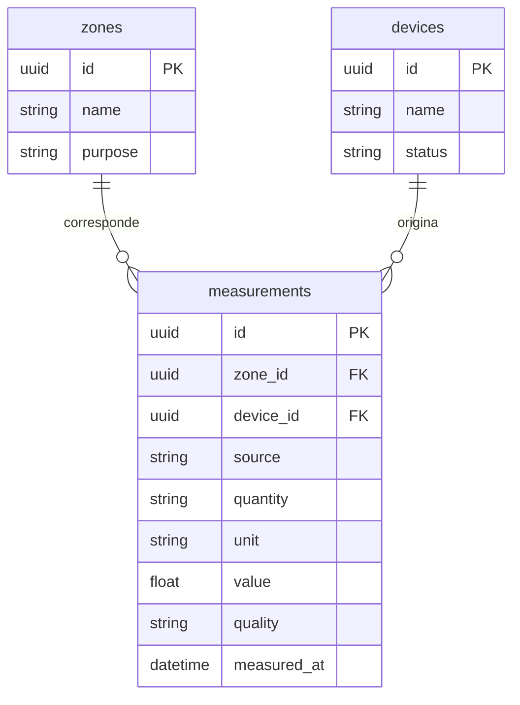

# Modelo de datos

## Esquema persistente de la Fase 1

Los identificadores son UUID. Las fechas públicas usan ISO 8601 con zona explícita; las escrituras se normalizan a UTC. Los nombres, propósitos y metadatos se introducen por una persona; no se precargan zonas ni dispositivos ficticios.

| Tabla | Campos | Reglas |
| --- | --- | --- |
| `zones` | `id`, `name`, `purpose`, `description?`, `created_at` | Nombre 1-80, propósito 1-160, descripción opcional 1-2000 caracteres |
| `devices` | `id`, `name`, `kind`, `model?`, `serial_port?`, `status`, `created_at`, `last_seen_at?` | `kind=esp32-s3`, `status=not_configured`; registrar metadatos no abre el puerto |
| `measurements` | `id`, `source`, `zone_id`, `device_id`, `quantity`, `unit`, `value`, `quality`, `measured_at`, `recorded_at`, `observations?` | Tabla reservada y vacía; sin ruta de ingesta, sin fixtures operativos |
| `alembic_version` | `version_num` | Control interno de migraciones |

`measurements.source` sólo permite `real`; `quality` admite `valid`, `invalid` o `unverified`. `zone_id` y `device_id` son claves foráneas con borrado restringido. `value` debe ser finito. La tabla no recibe datos en esta fase: todavía no existe un flujo de validación de sensores, magnitudes o unidades.

## Evolución diseñada, todavía no migrada

| Dominio | Entidades y relaciones previstas |
| --- | --- |
| Acceso | `users` y `roles`, relación de asignaciones; responsables enlazados a decisiones, registros manuales y auditoría |
| Instrumentación | `devices` 1:N `sensors`; `zones` 1:N `sensors`; `sensors` 1:N `calibrations`, `measurements` y estados de conexión; fallas asociadas al equipo |
| Calidad | Cada sensor define magnitud, unidad, calibración, vigencia máxima y estado. La última lectura válida se consulta del historial |
| Control | `actuators` pertenecen a dispositivo/zona; `commands` referencian autorización, límites y vencimiento; confirmaciones registran la ejecución o falla |
| Incidentes | `alerts` se sustentan en datos y reglas; `incidents` agrupan eventos y revisiones; cierre/recuperación conserva el historial |
| Recursos | `resources` y `resource_movements` por zona/lote, fuente, cantidad y unidad; separar medición, estimación y saldo calculado |
| Producción | Catálogos de especies/variedades; `seed_lots` 1:N `crop_cycles`; cosechas por ciclo, con liberación humana explícita y evidencia |
| Investigación | Lotes de biomasa y `biomass_trials`; controles, tratamientos, réplicas, mediciones, archivos y criterios de suspensión |
| Alimentación | `food_batches`, inventario/movimientos, ingredientes, versiones de `recipes`, resultados de inocuidad/vida útil y vínculos a cosechas liberadas |
| Cultura | `cultural_records` enlazan semillas, recetas o ensayos, con procedencia, consentimiento, condiciones de acceso, revisión y devolución |
| Escenarios | `scenarios` 1:N `scenario_results`; parámetros y versión propios; referencias opcionales a datos reales sin modificar su historial |
| Gobernanza | `decisions` enlazan datos, regla/versión, alternativas, acuerdo, responsable, revisión y resultado; `audit_events` conserva las acciones relevantes |

La ingesta futura añadirá `sensor_id` mediante una migración aditiva y verificará su coherencia con dispositivo y zona. Antes de exigirlo en datos históricos se diseñará la transición y se documentará la procedencia; no se fabricarán sensores para rellenar filas.

Los metadatos desconocidos permanecen nulos o pendientes. No guardar información desconocida como cero, texto «estable» ni cadena vacía. El modelo futuro de observaciones manuales identificará responsable, método y fuente sin presentarlas como telemetría instrumental.

## Conservación y privacidad

Las rutas actuales no eliminan ni reescriben historial. La integridad referencial está activa; la migración inicial bloquea su reversión destructiva. Cada migración futura debe revisar relaciones y consumidores. Para corregir evidencia, se diseñará un registro de corrección que preserve el original y su motivo.

Los escenarios tendrán tablas e historial independientes. La privacidad de bienestar y los permisos culturales requieren controles antes de habilitar esos módulos. No se incorpora contenido restringido ni consentimientos supuestos como datos iniciales.

Los formatos del expediente orientan la trazabilidad futura: ciclo, incidente y receta (p. 58); ciencia con identidad (p. 59); órdenes, responsabilidades y excepciones de emergencia (p. 60).
